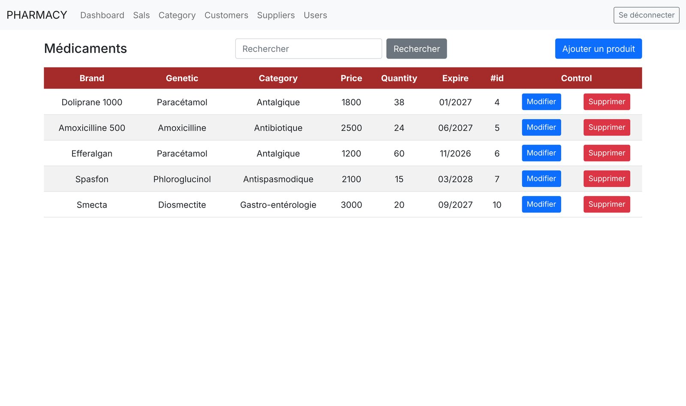
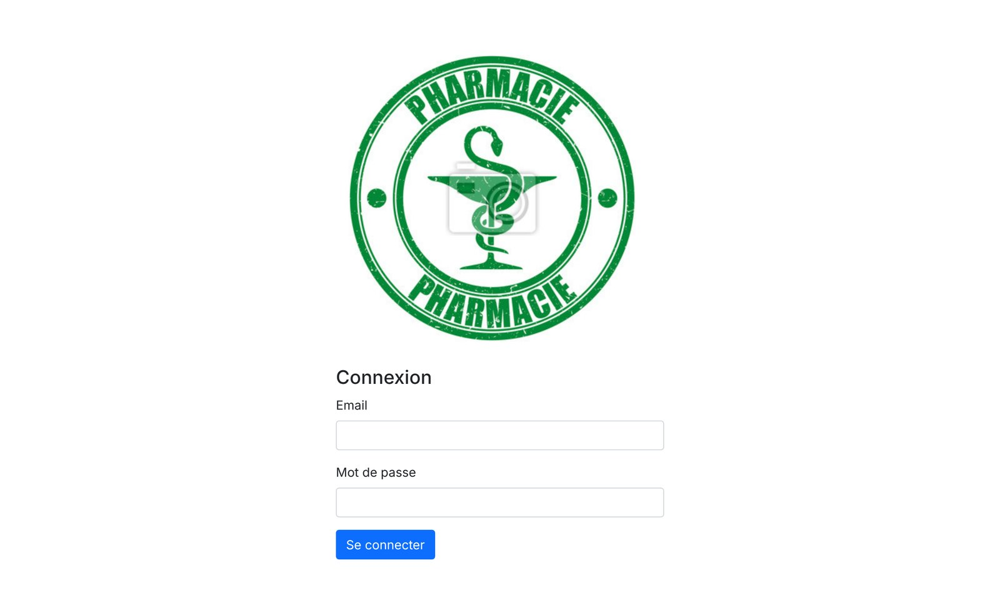
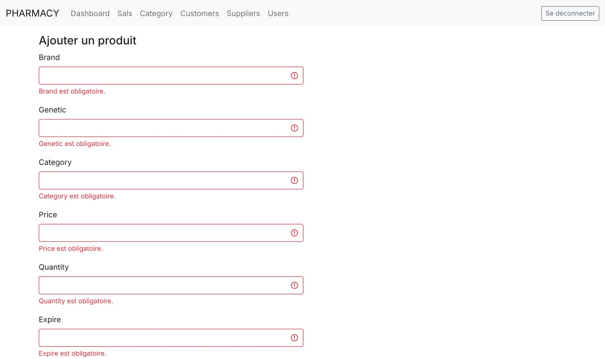

<p align="center"></p>

# Gestion de pharmacie

Application de gestion de pharmacie : stocks, ventes, clients et fournisseurs.

## Aperçu

<p align="center"><br><em>Tableau des médicaments</em></p>

<p align="center"><br><em>Écran de connexion</em></p>

<p align="center"><br><em>Formulaire avec contrôle des champs</em></p>

## Fonctionnalités

- Gestion du stock de médicaments et des catégories
- Suivi des ventes, des clients et des fournisseurs
- Recherche dans chaque tableau
- Gestion des utilisateurs et connexion par e-mail et mot de passe

## Technologies

PHP 8 · MySQL / MariaDB · PDO · Bootstrap 5

## Sécurité

- **Requêtes préparées partout** : aucune valeur envoyée par le navigateur n'est insérée dans le SQL.
- **Mots de passe hachés** (`password_hash`) et jamais affichés.
- **Pages protégées** : sans connexion, tout renvoie vers l'écran de connexion.
- **Jeton de formulaire (CSRF)** sur chaque ajout, modification, suppression et déconnexion ; les suppressions ne passent plus par un simple lien.
- **Affichage échappé** : un texte saisi ne peut pas injecter de HTML ni de script.
- **Aucun identifiant dans le code** : la connexion à la base se règle par variables d'environnement.
- Frein aux essais de connexion répétés, cookie de session `HttpOnly`, en-têtes `Content-Security-Policy` et `X-Frame-Options`.

## Lancer le projet

Prérequis : PHP 8.0 ou plus et MySQL ou MariaDB (par exemple avec XAMPP ou WAMP).

```bash
git clone https://github.com/mafallseye/application-gestion-de-pharmacie.git
cd application-gestion-de-pharmacie
mysql -u root -e "CREATE DATABASE pharmacie CHARACTER SET utf8mb4"
mysql -u root pharmacie < schema.sql
php scripts/creer_admin.php adresse@exemple.com
php -S localhost:8000
```

Puis ouvrir `http://localhost:8000` et se connecter avec le compte créé.

Par défaut, l'application se connecte à la base `pharmacie` sur `localhost` avec l'utilisateur `root` sans mot de passe (réglage d'un XAMPP local). Pour changer, définir `DB_HOST`, `DB_NAME`, `DB_USER` et `DB_PASS`.

### Mise à jour d'une base existante

Les anciens mots de passe étaient enregistrés en clair. Lancer une fois :

```bash
php scripts/creer_admin.php adresse@exemple.com
```

Le script élargit la colonne du mot de passe et crée le compte (ou change son mot de passe). Les autres comptes sont hachés automatiquement à leur prochaine connexion.

## Structure

```
inc/app.php       socle commun : base de données, session, protections, pages génériques
inc/config.php    réglages de connexion
index.php         connexion
tableau*.php      listes · form*.php, out_stocks.php, AddUser.php : ajouts
update*.php       modifications · delete*.php : suppressions
schema.sql        structure de la base
```

> Projet commencé en 2022 pendant ma formation, repris en 2026 pour corriger sa sécurité.

## Auteure

**Maguette Fall SEYE** — Développeuse Full Stack, Dakar (Sénégal) · [github.com/mafallseye](https://github.com/mafallseye)
